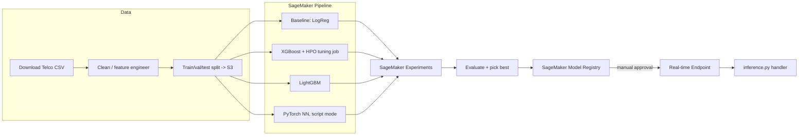

# MLOps on AWS — Customer Churn Prediction

End-to-end MLOps lifecycle on **Amazon SageMaker** for predicting customer
churn from account/usage/billing features (the public
[IBM Telco Customer Churn](https://github.com/IBM/telco-customer-churn-on-icp4d)
dataset — ~7,000 rows, 20 features, binary label).

This project is code/IaC-complete and ready to deploy against a real AWS
account. It has **not** been executed against live AWS resources from this
environment (no credentials available here) — see
[Running against a real AWS account](#running-against-a-real-aws-account).

## Lifecycle stages

| Stage | What happens | Where |
|---|---|---|
| Data | Download Telco churn CSV (synthetic fallback if offline), clean, feature-engineer | `src/data/` |
| Baseline | Logistic regression — cheap sanity check | `src/models/baseline.py` |
| Training | 3 candidate models: tuned XGBoost, LightGBM, small PyTorch feed-forward NN | `src/models/train_*.py` |
| Tracking | SageMaker Experiments (local-run fallback logs to `./experiments/`) | all training scripts |
| HPO | SageMaker Automatic Model Tuning over XGBoost hyperparameters | `sagemaker/pipeline.py` (tuning step) |
| Registry | Best model registered as a SageMaker Model Package (pending-manual-approval) | `src/registry.py` |
| Deployment | Real-time SageMaker endpoint from the approved model package | `sagemaker/deploy_endpoint.py`, `sagemaker/inference.py` |
| Orchestration | SageMaker Pipelines: preprocess -> train (x3) -> evaluate -> register | `sagemaker/pipeline.py` |
| IaC | Terraform: S3 buckets, IAM roles, ECR repo, SageMaker model-package group | `infra/` |
| CI/CD | Lint/test on PR; start SageMaker Pipeline execution on merge to main | `../.github/workflows/aws-mlops-ci.yml` |

## Architecture



## Repo layout

```
mlops-aws-churn/
  src/data/          download, cleaning, feature engineering
  src/models/        baseline, xgboost, lightgbm, pytorch NN trainers
  sagemaker/         SageMaker Pipelines definition, deploy + inference scripts
  infra/             Terraform IaC (S3, IAM, ECR, model package group)
  tests/             unit tests for preprocessing + model code
  configs/           training configuration
```

## Local development (no AWS needed)

```bash
cd mlops-aws-churn
python -m venv .venv && source .venv/bin/activate
pip install -r requirements.txt -r requirements-dev.txt

python -m src.data.download_data --output-dir ./data
python -m src.data.preprocess --input-dir ./data --output-dir ./data/processed
python -m src.models.baseline --data-dir ./data/processed
python -m src.models.train_xgboost --data-dir ./data/processed
python -m src.models.train_lightgbm --data-dir ./data/processed
python -m src.models.train_nn --data-dir ./data/processed
pytest tests/
```

Every training script writes metrics to `./experiments/<run_name>.json` when
no SageMaker Experiments context is available, so the full comparison across
baseline/XGBoost/LightGBM/NN can be run entirely locally.

## Running against a real AWS account

1. **Provision infra**
   ```bash
   cd infra
   terraform init
   terraform apply -var="project_name=mlops-churn" -var="aws_region=us-east-1"
   ```
2. **Upload processed data to the S3 bucket created by Terraform**
   ```bash
   aws s3 cp ./data/processed s3://<bucket_name>/processed/ --recursive
   ```
3. **Run the SageMaker Pipeline** (preprocess -> train x3 -> tune XGBoost -> evaluate -> register)
   ```bash
   python sagemaker/pipeline.py --role-arn <sagemaker_execution_role_arn> \
     --bucket <bucket_name> --pipeline-name mlops-churn-pipeline --submit --execute
   ```
4. **Approve the registered model package** in SageMaker Studio / via `boto3`
   once you're satisfied with the evaluation metrics.
5. **Deploy**
   ```bash
   python sagemaker/deploy_endpoint.py --model-package-arn <arn> --endpoint-name churn-endpoint
   ```
6. **CI/CD**: set repo secrets for AWS OIDC (`AWS_ROLE_TO_ASSUME`, `AWS_REGION`)
   and `SAGEMAKER_EXECUTION_ROLE_ARN`, `SAGEMAKER_BUCKET`; the
   `aws-mlops-ci.yml` workflow starts a pipeline execution on merges to
   `main` that touch this directory.

## Model comparison (fill in after running)

| Model | Val AUC | Val F1 | Notes |
|---|---|---|---|
| Baseline (LogReg) | — | — | scaled numeric + one-hot categorical features |
| XGBoost (tuned) | — | — | SageMaker Automatic Model Tuning, 20 trials |
| LightGBM | — | — | default hyperparameters |
| PyTorch NN | — | — | 2 hidden layers, script-mode training |
