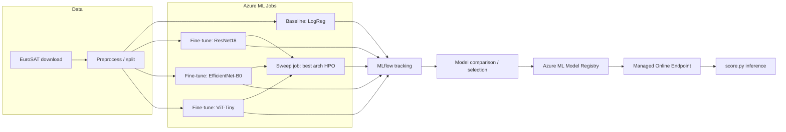

# MLOps on Azure — Satellite Land-Cover Classification

End-to-end MLOps lifecycle on **Azure Machine Learning** for classifying
Sentinel-2 satellite image patches into 10 land-use/land-cover classes using
the [EuroSAT](https://github.com/phelber/EuroSAT) dataset (RGB variant,
27,000 images, 64x64px, permissively licensed).

This project is code/IaC-complete and ready to deploy against a real Azure
subscription. It has **not** been executed against live Azure resources from
this environment (no credentials available here) — see
[Running against a real subscription](#running-against-a-real-subscription).

## Lifecycle stages

| Stage | What happens | Where |
|---|---|---|
| Data | Download + version EuroSAT, split train/val/test | `src/data/` |
| Baseline | Logistic regression on flattened pixels — cheap sanity check | `src/models/baseline.py` |
| Fine-tuning | Transfer-learn 3 architectures (ResNet18, EfficientNet-B0, ViT-Tiny) | `src/models/finetune.py`, `azureml/job-finetune-*.yml` |
| Tracking | MLflow autologging to the Azure ML workspace's tracking URI | all training scripts |
| HPO | Azure ML sweep job over the winning architecture's learning rate/weight decay | `azureml/sweep-job.yml` |
| Registry | Register the best run's model as a versioned Azure ML Model asset | `src/models/registry.py` |
| Deployment | Managed online endpoint serving the registered model | `azureml/endpoint.yml`, `azureml/deployment.yml`, `src/serve/score.py` |
| Orchestration | Azure ML pipeline chaining data prep -> train -> evaluate -> register | `azureml/pipeline.yml` |
| IaC | Bicep: resource group, workspace, storage, key vault, ACR, compute cluster | `infra/` |
| CI/CD | Lint/test on PR; submit Azure ML job on merge to main | `../.github/workflows/azure-mlops-ci.yml` |

## Architecture



## Repo layout

```
mlops-azure-landcover/
  src/data/          dataset download, preprocessing, torch Dataset
  src/models/        baseline, fine-tune trainer, registry helper
  src/serve/         online-endpoint scoring script
  azureml/           Azure ML CLI v2 job/pipeline/endpoint YAML specs
  infra/             Bicep IaC for the Azure ML workspace and dependencies
  tests/             unit tests for data + model code
  configs/           YAML configs for data and training
```

## Local development (no Azure needed)

```bash
cd mlops-azure-landcover
python -m venv .venv && source .venv/bin/activate
pip install -r requirements.txt -r requirements-dev.txt

python -m src.data.download_eurosat --data-dir ./data
python -m src.models.baseline --data-dir ./data --epochs 5
python -m src.models.finetune --data-dir ./data --arch resnet18 --epochs 3
pytest tests/
```

Every script also runs standalone with `mlflow.set_tracking_uri("file:./mlruns")`
when no Azure ML tracking URI is configured, so the full training loop and
metrics comparison can be exercised entirely locally.

## Running against a real subscription

1. **Provision infra**
   ```bash
   az login
   az group create -n rg-mlops-landcover -l eastus
   az deployment group create -g rg-mlops-landcover -f infra/main.bicep -p infra/parameters.json
   ```
2. **Point the Azure ML CLI at the workspace**
   ```bash
   az configure --defaults group=rg-mlops-landcover workspace=mlops-landcover-ws
   ```
3. **Submit jobs**
   ```bash
   az ml job create -f azureml/job-baseline.yml
   az ml job create -f azureml/job-finetune-resnet18.yml
   az ml job create -f azureml/job-finetune-efficientnet.yml
   az ml job create -f azureml/job-finetune-vit.yml
   az ml job create -f azureml/sweep-job.yml
   ```
4. **Register the winning model** (after comparing MLflow runs in Azure ML Studio)
   ```bash
   python -m src.models.registry --run-id <best_run_id> --model-name eurosat-landcover
   ```
5. **Deploy**
   ```bash
   az ml online-endpoint create -f azureml/endpoint.yml
   az ml online-deployment create -f azureml/deployment.yml --all-traffic
   ```
6. **CI/CD**: set repo secrets `AZURE_CREDENTIALS` (federated OIDC or service
   principal JSON), `AZURE_RESOURCE_GROUP`, `AZURE_ML_WORKSPACE` and the
   `azure-mlops-ci.yml` workflow will submit the pipeline job automatically on
   merges to `main` that touch this directory.

## Model comparison (fill in after running)

| Model | Val Accuracy | Val F1 (macro) | Params | Notes |
|---|---|---|---|---|
| Baseline (LogReg) | — | — | — | pixel-flattened baseline |
| ResNet18 (fine-tuned) | — | — | 11.2M | ImageNet-pretrained |
| EfficientNet-B0 (fine-tuned) | — | — | 5.3M | ImageNet-pretrained |
| ViT-Tiny (fine-tuned) | — | — | 5.7M | ImageNet-pretrained |
